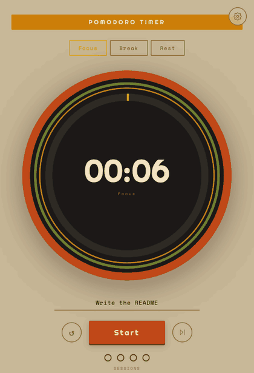
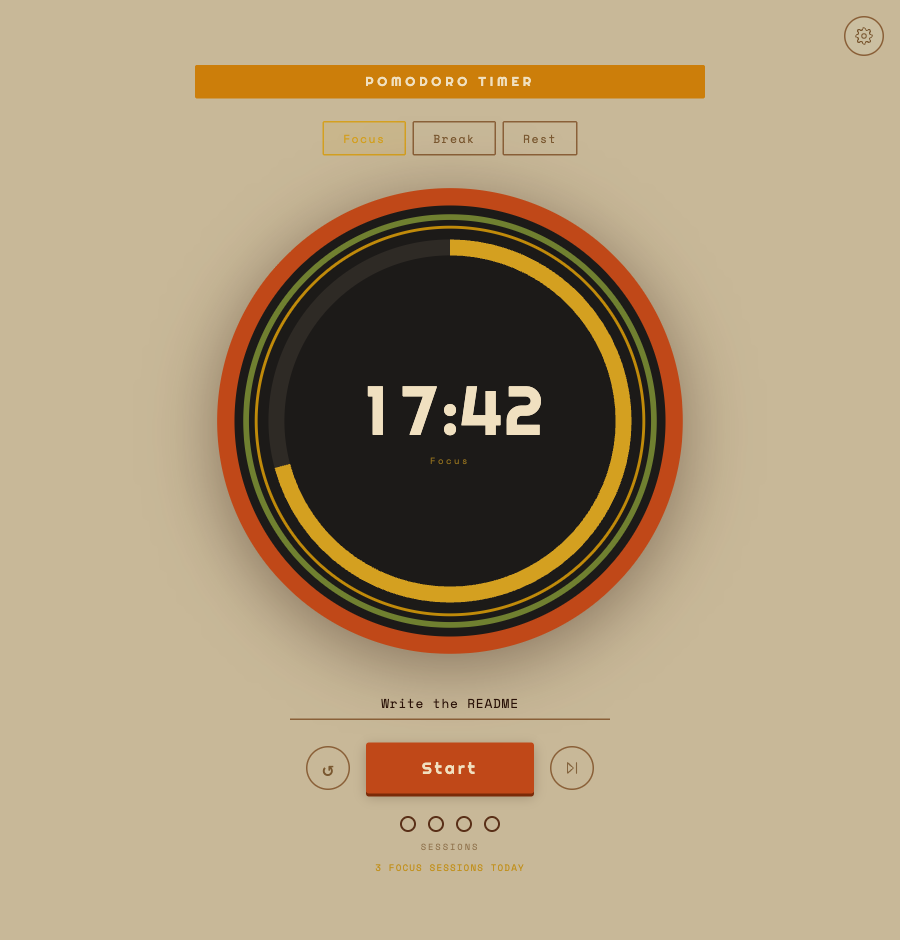
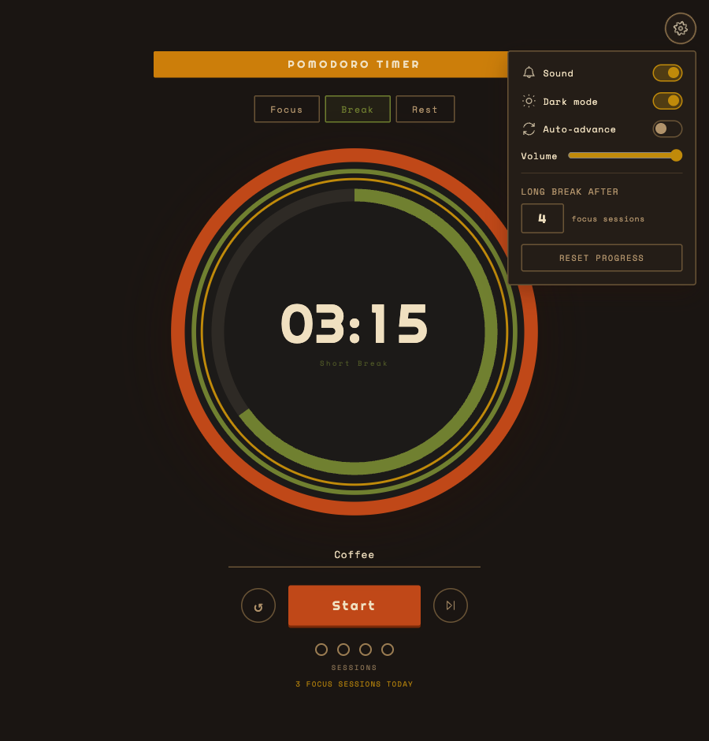
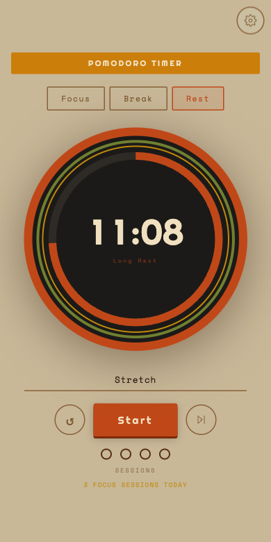

# Pomodoro Timer

En liten Pomodoro-timer i 70-tallsstil – varm beige, jordfarger og en solid urskive. Laget for moro skyld, og fordi jeg ville ha en timer jeg faktisk likte å se på.

<p align="center">
  
</p>

## Skjermbilder

| Lyst | Mørkt |
| :---: | :---: |
|  |  |

<p align="center">
  
</p>

## Hva den gjør

- Fokus, kort pause og lang pause, med lang pause hver 4. økt (kan justeres)
- Klikk på tiden for å endre varigheten
- Kan gå automatisk videre til neste økt
- En rolig lyd og et varsel i nettleseren når en økt er ferdig
- Mørk modus
- Hurtigtaster: `Space` start/pause, `R` nullstill, `S` hopp over, `1` `2` `3` bytt modus
- Husker hvor du var hvis du laster siden på nytt
- Fanetittelen og favikonet viser nedtellingen

## Kjøre lokalt

```bash
npm install
npm run dev
```

Åpne deretter [localhost:3000](http://localhost:3000). Testene kjøres med `npm test`.

Laget med Next.js, TypeScript og Tailwind CSS. Lyden genereres med Web Audio API, så det finnes ingen lydfiler.
